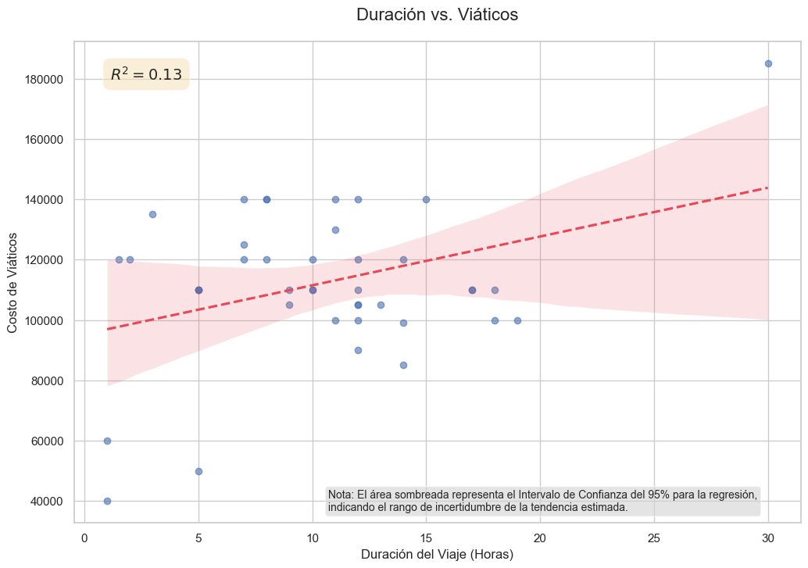

# Route Cost Analysis


Análisis exploratorio de datos sobre rutas de transporte de carga: compara el costo de peajes entre rutas alternativas, estudia la relación entre la duración del viaje y los viáticos, y mide qué tanto difieren las fuentes de kilometraje (Google Maps, Waze y ViaMichelin) frente a un valor de referencia.



## Preguntas que responde

1. ¿Cuánto varía el costo de peajes entre las alternativas de una misma ruta?
2. ¿Qué variables (peso, duración, combustible, viáticos) se relacionan con ese costo?
3. ¿Los viáticos guardan una relación coherente con la duración del viaje? ¿Qué viajes son anómalos?
4. ¿Qué tan distintas son las fuentes de kilometraje y cuál sería el impacto económico anual de esa diferencia?

**Los datos originales son confidenciales y no se incluyen en este repositorio.**

## Metodología

1. **Limpieza:** los ceros se tratan como datos faltantes (`NaN`) solo en las columnas donde un cero es un valor imposible (peajes, duración, peso, etc.).
2. **Segmentación:** las rutas se separan en grupos con 2 y con 3 alternativas disponibles.
3. **Ingeniería de métricas:** costo de viáticos (comida + alojamiento) y costo total gestionable por alternativa.
4. **Comparación entre alternativas:**
   - Distribuciones de costos absolutos (histogramas, polígonos de frecuencia y diagramas de caja).
   - Normalización por Z-score y por desviación porcentual respecto a la media.
   - Diferencia absoluta y diferencia relativa entre pares de alternativas.
5. **Correlaciones:** matrices de correlación por alternativa y global.
6. **Anomalías en viáticos:** regresión lineal entre duración y viáticos, con R² para cuantificar la relación.
7. **Kilometraje:** normalización min-max, diferencias absolutas y porcentuales frente a la referencia, e impacto monetario anualizado.

## Estructura del repositorio

```
route-cost-analysis/
├── README.md
├── requirements.txt
├── data/
├── notebooks/
│   └── 01_route_cost_exploratory_analysis.ipynb
└── export-01/
    └── grafics.png
    └── abstrac.docx
```

## Cómo ejecutarlo

```bash
git clone https://github.com/lpolobeltran/route-cost-analysis.git
cd route-cost-analysis

python -m venv .venv
source .venv/bin/activate        # en Windows: .venv\Scripts\activate
pip install -r requirements.txt

jupyter notebook notebooks/
```

## Tecnologías

- Python 3.12
- pandas y NumPy para manipulación de datos
- seaborn y matplotlib para visualización
- SciPy y scikit-learn para estadística y regresión
- openpyxl y Pillow para lectura de Excel y manejo de imágenes
- Jupyter Notebook

## Nota

Análisis desarrollado en 2025. Repositorio reorganizado y anonimizado en 2026 para su publicación.
